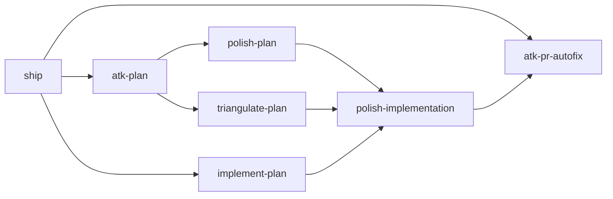

# Skills

## Skill map

## Skills reference

### Orchestration

- [`$ship`](../skills/ship/SKILL.md) — Runs an open-ended request through the whole pipeline unattended: reframe → plan → implement → polish → CI, on a fresh worktree and branch with a draft PR

### Planning

- [`$atk-plan`](../skills/atk-plan/SKILL.md) — Turns a rough idea into an actionable plan: judgement calls instead of interviewing, every call documented under `## Decisions` for veto at review
- [`$metaplan`](../skills/metaplan/SKILL.md) experimental — Living notebook for multi-slice projects spanning multiple tickets/PRs

### Refining

- [`$polish-plan`](../skills/polish-plan/SKILL.md) — Strengthen a plan into an implementation-ready plan via a subagent review loop, catching inaccuracies before execution
- [`$triangulate-plan`](../skills/triangulate-plan/SKILL.md) — Generate an independent second opinion on a plan and merge the best of both into an implementation-ready plan

### Implementing

- [`$implement-plan`](../skills/implement-plan/SKILL.md) — Implements a plan's PR breakdown via subagents, one worktree and PR per slice; starting unblocked slices and unblocking dependents as their base branch lands code
- [`$polish-implementation`](../skills/polish-implementation/SKILL.md) — Iterative code review loop against a GitHub PR; self-review threads get fixed, replied to, and resolved, up to 10 passes
- [`$trim-tests-and-comments`](../skills/trim-tests-and-comments/SKILL.md) — Reports, then cuts, weak tests and low-value comments added on the branch
- [`$prose-deslop`](../skills/prose-deslop/SKILL.md) — Flags AI-sounding prose, clichés, filler, and unnatural phrasing in added prose and code comments

### Shipping

- [`$atk-pr-autofix`](../skills/atk-pr-autofix/SKILL.md) — Monitor a PR's CI status in a loop until it passes or needs human input
- [`$pr-description`](../skills/pr-description/SKILL.md) — Guidelines for PR titles and bodies: lead-in statement, call graph, dependency-update analysis
- [`$pr-review-guide`](../skills/pr-review-guide/SKILL.md) — Reviewer walkthrough narrative: call graph, chapters, sequence diagrams, decision points
- [`$minimise-pr-comments`](../skills/minimise-pr-comments/SKILL.md) — Hides low-signal PR comments and reviews (bot noise, superseded review passes) while keeping signal

### Reviewing

- [`$atk-code-review`](../skills/atk-code-review/SKILL.md) — Structured code review that posts findings as GitHub PR review threads (or plain text when no PR exists)
- [`$pr-risk-assessment`](../skills/pr-risk-assessment/SKILL.md) — Rates PRs on a 5-level risk scale to triage how carefully they need reviewing
