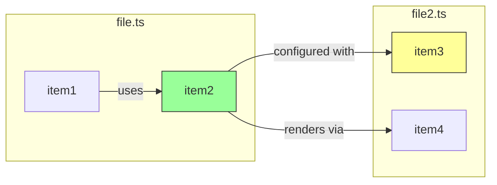

## Body format

Explain this pr in 100 words or less.

Guidelines:

- Prefer to show by example if possible
- Prefer to illustrate with code blocks
- Include example data: real inputs and outputs (a command's output, a before/after value, a sample payload). Show what a reader would see, not just how it works
- Explain the why
- Skimmable format
- Target audience: someone who has not worked on this feature in the codebase
- Use h2's for content separation
- Mention prior art. If this change mirrors similar conventions, cite those as proof
- Avoid restating diff. no file/function lists (reviewers see the diff), no "what this PR doesn't change".


Lead-in statement:

- Use minto principle; lead with important statement in h3
- End with a fullstop
- 12 words max
- Ensure an h2 follows after it

Sections:

- If code is changed, add a *Call graph*
- If dependencies is changed, add a *Dependency update analysis*

Brevity:

- Optimise for human viewing. 100 words or less. Any information that needs to be there but doesn't fit: encase in `<details>`.
- Keep all `<details>` at the end
- Don't precede `<details>` with headings

## Body format example

```
### <important lead-in statement.>

## <section>

<additional details>

<details>
<summary>{title}</summary>
…
</details>
```

## Title format

Aim for 10 words max.

```
[TICKET] <Area>: short description in imperative form
```

Examples:

```
[ABC-123] Billing: add support for USD
[Chore] Build: fix type checking script
```

For stacked PR's, include PR number:

```
[ABC-123] [1] Add data model
[ABC-123] [2] Populate data
```

## Call graph

Create a call graph of the key functions and entities in this PR.

- use Mermaid graphs with \`graph LR\`.
- highlight the new ones in green, updated ones in yellow, removed references in red.
- also include any references removed.
- if possible, search the repo to find references to what uses new/updated components, even if they are not part of the PR.
- Trace them all the way back to the entry points (eg, API route, GraphQL query/mutation, event handler, and so on).

Example format:

~~~~~
<details>
<summary>Call graph</summary>



</details>
~~~~~

## For dependency updates

If any dependencies were updated, include these information in the PR desc to help out reviewers:

- Audit changes: How has this changed `pnpm audit`'s count of open vulnerabilities?
- User-facing impact: which user features/journeys are using this dependency?
- Internal impact: which developer tooling are using this dependency?
- Notable changes: what are notable changes in this new version?

~~~~~
<details>
<summary>Dependency update analysis: {dependency}</summary>

…
</details>

