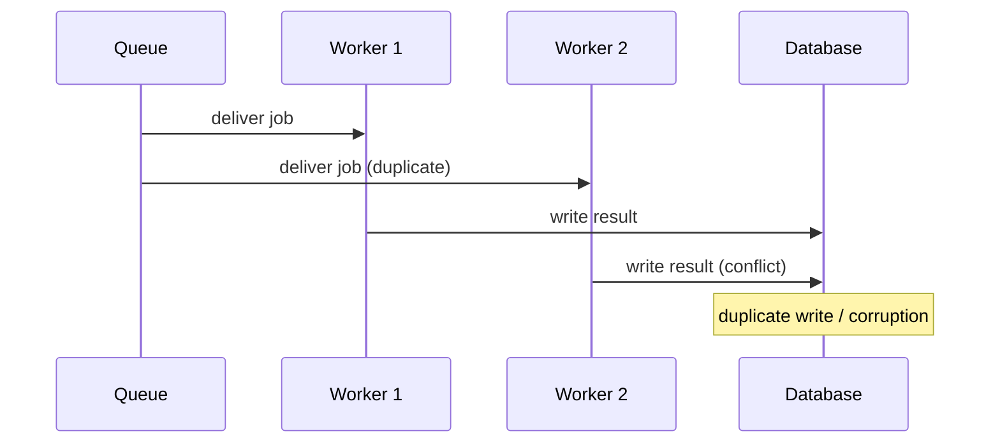
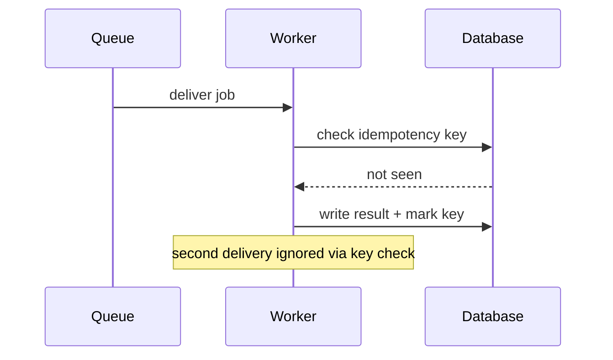

## Workflow

Create a pull request review guide for this pull request.

When done:

- Save to `~/.artefacts/<title>.md`

- Check this PR description if there's already a PR review guide comment.

- Post a PR comment. If a PR review guide comment already exists, edit that instead. If the PR is NOT authored by me, surround it in a `<details>` shell with explanations (below).

  ```
  <details><summary>PR explanation</summary>

  {short explanation based on the `$pr-description` skill}

  </details>

  <details><summary>PR review guide</summary>

  {review guide here}

  </details>
  ```

- If this PR is authored by me, update the description to add this at the top:

  ```
  > 💡 Check out the [PR review guide](https://…#issuecomment-‥).
  ```

## Creating a PR review guide

Create a narrative that would lead a reviewer through incremental steps that explain one piece of information at a time.

Omit any sections that may not be relevant or helpful (eg, a sequence diagram may not be needed for simple changes).
Try to order sections like so:

- Call graph (h2)
- Chapters (h2's)
- Decision points (h2)
- Sequence diagram (h2)
- Dependency updates (h2)
- Concepts (h2)
- Example data (h2)
- FAQ (h2)
- Feedback points (h2)

### Example data

Include an **Example data** section (h2) so a reviewer can see the change working, not only read it.

- Use real data: copy it from a run (command output, API response, a before/after value, a sample payload, a log line). Never invent it.
- Show one input and its output per example, labelled in bold. Prefer 2–4 short examples that cover the main path and a notable edge case.
- Put each in a code block, trimmed with `...` where it is long.
- Say how it was produced if a reviewer might want to reproduce it (the command run).

### Concepts

- List down key concepts and terminologies that need to be understood for this pull request.
- List down each concept as an h3 with a short description.

Example concept:

~~~~~
## Concepts

- `identifier` — Short description
- **Concept name**— Short description
~~~~~


### Call graph

Create a call graph of the key functions and entities in this PR.

- use Mermaid graphs with \`graph LR\`.
- highlight the new ones in green, updated ones in yellow, removed references in red.
- also include any references removed.
- if possible, search the repo to find references to what uses new/updated components, even if they are not part of the PR.
- Add reference letters like `[A]` and `[B]` to correlate them to the other sections below.
- Trace them all the way back to the entry points (eg, API route, GraphQL query/mutation, event handler, and so on).

Example format:

~~~~~
## Call graph

\``mermaid
graph LR
  subgraph "file.ts"
    A["item1"]
    B["[A] item2"]:::new
  end
  subgraph "file2.ts"
    C["item3"]:::updated
    D["item4"]
  end
  A -->|"uses"| B
  B -->|"configured with"| C
  B -->|"renders via"| D

  classDef updated fill:#ff9,stroke:#333,color:#333
  classDef new fill:#9f9,stroke:#333,color:#333
  classDef removed fill:#f99,stroke:#333,color:#333
```
~~~~~

### Sequence diagrams

Use Mermaid `sequenceDiagram` blocks to illustrate the _before/after behaviour_ of the key change. This is most valuable for bug fixes, race conditions, async flows, or any change where timing/order matters.

Produce 2–3 diagrams:

1. **Before (bug/problem):** Show the broken or old flow that motivated the PR.
2. **After (happy path):** Show the correct flow introduced by the fix.
3. **Edge/race case** _(optional)_: Show a notable failure mode or alternative path the fix accounts for.

Place these after the Call graph section.

Guidelines:

- Keep diagrams short — 5–8 steps each. Omit low-level detail not relevant to the change.
- Label actors with short names matching the actual code entities (services, functions, queues).
- Use `Note over Actor: text` to annotate key state transitions or decisions.
- Use `activate`/`deactivate` sparingly — only when call stack depth aids understanding.
- Quote labels that contain special characters or spaces: `Actor->>Other: "message"`.
- Consult the Mermaid docs for syntax guidelines if needed.

Example format:

````
## Sequence diagrams

### Before: double-processing bug



### After: idempotent processing


````


### Chapters

Divide the review guide into chapters.

A chapter can introduce or expound on:

- an existing piece of code,
- a code change,
- a concept with diagrams

Each chapter should have:

- Chapter name (max 8 words)
- Short description explaining what it does
- If it references code in the PR:
  - Link to files (https://github.com/<user>/<repo>/blob/<branch>/<filepath>#L<line>-L<line>)
  - Add cross-reference markers for each file (eg, `[A]`)
  - Diff codeblocks, per file, with some of the key changes

Guidelines:

- Chapters can show code blocks, describe a concept, or anything that helps the user understand the change.
- Only show highlights in the codeblocks. Simplify code for brevity if it helps readability. Avoid including all code changes.

Example chapters:

~~~~~
## 1. Chapter name

Short description does here

[**path/to/filename.ts** lines 3-10](...) `[A]`

```diff
.
.
```

Key points:

- ...
- ...
~~~~~


~~~~~
## 1. Chapter name

Short description does here

```mermaid
.
.
```
~~~~~

### Dependency updates

If there are dependency updates:

- Assess its impact. Check if there are any breaking changes.
- Summarise why the dependency is needed. Use `grep` and `bun why`
- Consult the web for change logs.
- Assess code paths where that dependency is used.

For each dependency update, MUST also include these four items:

- **Audit changes** — How has this changed the project's count of open vulnerabilities (eg, `pnpm audit`)?
  - Run the audit on the base branch and on the PR branch; report the before → after counts (by severity if useful).
  - List advisories fixed or newly introduced (with IDs, eg GHSA/CVE).
- **User-facing impact** — Which user features/journeys use this dependency?
  - Trace usages (`grep`, `pnpm why`) back to entry points (pages, API routes, GraphQL operations, jobs) and name the feature/journey.
  - Say which apps/packages ship it to end users (eg, webapp bundle, API runtime).
- **Internal impact** — Which developer tooling uses this dependency?
  - eg, build, lint, test, CI, codegen, scripts, dev servers.
  - Say if it is a dev-only dependency with no runtime exposure.
- **Notable changes** — What are notable changes in this new version of the dependency?
  - Breaking changes, deprecations, new defaults, security fixes, and behaviour changes that matter to this repo.
  - Link the changelog/release notes.

Example format:

```
## Dependency update: `@sendgrid/mail`

`@sendgrid/mail` (7.2.1 → 8.0.0)

**Audit changes:**

- `pnpm audit` open vulnerabilities 5 → 3 (fixes GHSA-xxxx-xxxx-xxxx high, GHSA-yyyy-yyyy-yyyy moderate)

**User-facing impact:**

- Welcome and password-reset emails (`notifySubscribers()` ← `signUp` mutation)
- Shipped in: API runtime only

**Internal impact:**

- Used by `scripts/send-test-email.ts` (developer tooling)
- Not used in build/lint/test tooling

**Notable changes:**

- ⚠️ Breaking change: `send()` method now returns promise with different structure — verify error handling in `notifySubscribers()`
- Changelog: https://github.com/sendgrid/sendgrid-nodejs/releases/tag/v8.0.0
```

### Decision points

Decision points are the "why" of the change. A reviewer reads code and asks "why not X?" — the guide should answer before they ask.

**Source:** pull decisions from the PR's plan/metaplan doc (usually records stakes, chosen, why, alternatives). If none exists, reconstruct from the diff and commit messages. Re-ground every decision in the actual code — the plan may have drifted.

Each decision needs:

- **Chosen** — what the code does
- **Why** — the concrete reason (an invariant it preserves, a cost it avoids)
- **Rejected alternatives with failure modes** — for each: what it was AND what observably breaks if you take it. Name the failure with specifics (numbers, behavior), not a label.
- **Affects** — files/symbols touched, cross-referenced to call graph markers (eg `[A]`)

Example:

~~~~
**Decision (D3):** band change **discards** the unplayed lower-band pool.
**Why:** band = f(level), not pool position; pools dwarf band lengths (187/135/80/63 vs 3/5/5 rounds), so discarding costs ~nothing.
**Rejected — drain the current band before switching:** the ladder becomes pool-size-driven. With 187 band-1 puzzles, rounds 1–187 stay band 1. Pool length, not level, paces the ramp.

```ts
// drain-first advance — keep popping, no rebuild on crossing
const next = nextPuzzle(state.pool, state.catalog, band, rng)
// round 4 can still serve a band-1 puzzle (184 left in pool)
```

**Affects:** `pool.ts` → `nextPuzzle`, `bandAdvance` `[A]`
~~~~

### FAQ

Try to predict some questions a reviewer might ask, and include short answers.

Example:

~~~~~
## FAQ

> Q: Will this [...]?

A: Yes. After the [...]
~~~~~

### Feedback points

Look at the changes and provide thoughtful feedback on:

- Code quality and best practices
- Potential bugs or issues
- Suggestions for improvements
- Overall architecture and design decisions
- Security: vulnerabilities and concerns
- Documentation consistency: Verify that README.md and other documentation files are updated to reflect any code changes (especially new inputs, features, or configuration options)

For each feedback point, give it a priority:

- P1 - Must address before merging
- P2 - Somewhere in between
- P3 - Nitpicks

General notes:

- Aim for brevity
- Avoid too many positive points ("Readme is updated, examples are clear, no security issues"). There should only be one sentence of positive points max. This helps us concentrate on actionable feedback.

Be constructive and specific in your feedback. Give inline comments where applicable.

Example format:

````
## Feedback points

### [P2] Extract magic numbers

- See: `blog/publish.ts:89`
- Consider defining constants for numbers for clarity.

 ```typescript
 // Current:
 if (post.content.length < 100) { ... }

 // Suggest:
 const MIN_POST_LENGTH = 100;
 if (post.content.length < MIN_POST_LENGTH) { ... }
 ```


### [P3] Type safety concern

- See: `blog/types.ts:12`
- `post.scheduledDate` is optional but `scheduleForPublication()` doesn't validate it
- Could result in runtime errors - add validation or make type non-nullable
