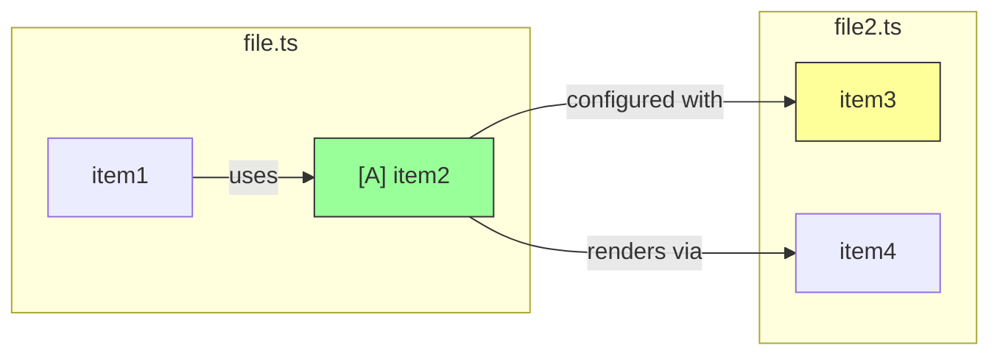
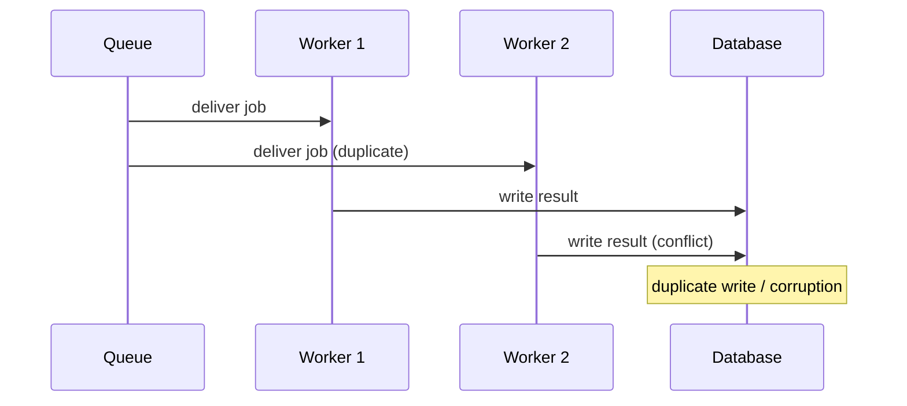
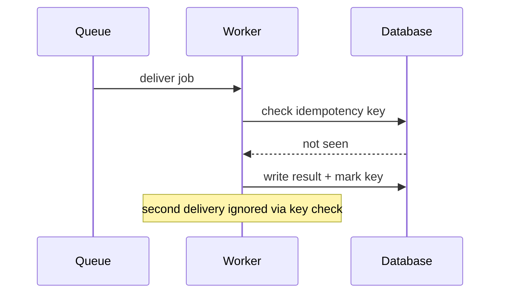

## Workflow

Create a pull request review guide for this pull request.

When done:

- Save to `~/.artefacts/<title>.md`

- Validate every Mermaid block before posting. Fix any block that fails and re-run until it exits 0. Never post with failures. This needs network access for `npx` on first run, and takes ~15-20s (it launches headless Chromium). Passing locally does not guarantee GitHub renders it, as GitHub's Mermaid lags upstream.

  ```sh
  <SKILL_DIR>/check-mermaid.sh ~/.artefacts/<title>.md
  ```


- Check this PR description if there's already a PR review guide comment.

- Post a PR comment. If a PR review guide comment already exists, edit that instead. Surround it in a `<details>` shell with explanations (below).

  ```
  > :robot: This is an automated PR review guide for the benefit if reviewers, it is *not* human feedback on this PR. — Automated agent

  {at a glance infographic}

  <details><summary>Review guidde</summary>

  {review guide here}

  </details>

  <details><summary>LOC report</summary>

  {see `<SKILL_DIR>/loc-report.md`}

  </details>
  ```

- If this PR is authored by me, update the description to add this at the top:

  ```
  > 💡 Check out the [PR review guide](https://…#issuecomment-‥).
  ```

- After posting or editing the comment, fetch the body you actually sent and re-run the check on it:

  ```sh
  gh api repos/<owner>/<repo>/issues/comments/<id> --jq .body > /tmp/pr-guide-check-$$.md
  <SKILL_DIR>/check-mermaid.sh /tmp/pr-guide-check-$$.md
  ```

## Creating a PR review guide

Create a narrative that would lead a reviewer through incremental steps that explain one piece of information at a time.

Omit any sections that may not be relevant or helpful (eg, a sequence diagram may not be needed for simple changes).
Try to order sections like so:

- Problem (h2)
- Background (h2)
- Call graph (h2)
- Decision points (h2)
- Chapters (h2's)
- Sequence diagram (h2)
- Dependency updates (h2)
- Concepts (h2)
- Example data (h2)
- FAQ (h2)
- Feedback points (h2)

### Prefer visuals

Show before telling. For each section, pick the visual form first and fall back to prose only when none fits.

- **Numbers to compare** (line counts, latency, counts before/after, per-file size): draw a bar chart in the infographic, with before as a light bar and after as a solid bar overlaid. Never list them as prose or a bare table. A single count (eg, `5 → 0` steps) is a big-number label, not a one-row chart.
- **Flow, order, state, dependencies:** Mermaid (call graph, sequence diagram, state diagram).
- **UI changes:** annotated screenshots or mockups traced from real screenshots.
- **Review attention:** mark where a reviewer should look on the visual itself (amber `!` marker, red/green/yellow overlay), not in a separate paragraph.
- **One form per idea:** never show the same content as both a chart and a list. If the infographic carries it, the guide only links to it.
- **Totals must reconcile:** compute chart totals from the same data as the LOC report (`git show <base>:<file> | wc -l`), and cross-check. A mismatch costs reviewer trust.
- **Render and look:** convert the SVG (`rsvg-convert -w 1800 x.svg -o x.png`) and inspect it before posting. Fix overflow, clipped text and long bars.

### At a glance infographic

Draw an SVG infographic that a reviewer can understand without reading the guide.

**Start from what exists:**

- If the PR description already has an infographic, start from its source and build on it. Never post a weaker redraw.
- If real screenshots exist (PR description, test runs, local artefacts), trace mockups from them: same layout, element order, colours and copy. Never draw a generic wireframe (grey avatar circle, placeholder bars).

**Content:**

- Explain the problem, solution, before/after.
- Lay it out as numbered panels in reading order (`1 · …`, `2 · …`). Each panel answers a different question; never restate a fact another panel already shows.
- **Draw the changed system, not a list about it.** When the PR changes a pipeline, waterfall, state machine or call chain, draw its real elements in code order as a before row and an after row, and style what changed in place: skipped (red, dashed, struck through), narrowed (amber, with a short sublabel), unchanged (plain). Read the order from the code at the head commit.
- **Review hotspots panel:** when the guide has risky decisions or open feedback points, give each one a card with an amber `!` marker and its guide reference (`D4`, `FP3`), so the reviewer knows where to spend time. Keep trivial plumbing off it.
- **State the safety claim:** when the PR claims no change for existing paths (dark launch, opt-in option, flag off), show it as a short ✅ checklist of what stays identical, plus how it was verified.
- Title (h1) states the outcome, not the topic (eg, "Duplicate queue deliveries are now skipped", not "Queue worker changes"). Max 9 words.
- Add a one-line subheading under the title that explains the idea further (the why or mechanism, eg, "Later steps only add fields, so the first result is final"). Never repeat the ticket ID, PR number or other metadata there; the PR already shows those.
- In screenshots, highlight changed areas with overlay boxes with red/green/yellow strokes.

**Format:**

- Light mode: background `#F0F0F3`, white panels (`#ffffff`, stroke `#d0d7de`), dark text (`#1f2328`, muted `#59636e`). Use GitHub-light accent colours with enough contrast on white (green `#1a7f37`, red `#cf222e`, amber `#9a6700`, blue `#0969da`). Bars that carry white labels need a dark fill (`#6e7781`). Never use a dark background.
- Embed in the comment. GitHub renders SVG attachments, so attach the SVG directly.
- Note that `gh` CLI supports image attachments (`gh pr comment 13 --attach ./before.png --attach ./after.png`).
- Include the local source file in a HTML comment: `<!-- Source: ~/... -->` so future edits can be done.
- Look at the SVG before posting. Fix overlapping or clipped text, and any panel that needs the guide to make sense.

### Problem

Include a **Problem** section (h2) as the first section, so a reviewer knows what is being fixed before seeing how.

- Minto + list: open with one bold sentence that states the problem (the conclusion), then a short list of supporting facts beneath it.
- Each list item is one line: what breaks, for whom, how often, or why the obvious fix doesn't work. Nest details only when needed.
- Describe the observable problem first; the fix goes only in the closing `**This PR:**` bullet.
- Ground it in evidence: ticket/PR description, incident, metric, error message. Use real numbers; never invent them.
- Close with one `**This PR:**` bullet saying in one or two lines what the PR does. There is no separate "PR explanation", so Problem is the reviewer's summary.
- Omit the section only if the PR has no problem to state (eg, pure chore or refactor), and say so in one line instead.

Example:

~~~~~
## Problem

**The old event router can't be removed yet: two legacy background jobs still send ~20k identify calls/week through it.**

- The event router is being removed before its contract renews (PROJ-123)
- Deleting the calls isn't safe:
  - nothing else sets `firstName`, `lastName`, `createdAt` or signup `role`/`plan` on analytics user profiles
  - `email` feeds the ad conversion model, so new signups would drop out of matching
- **This PR:** sends both identifies straight to the analytics provider with the same trait names and user ID, awaits a flush, and drops the event router packages and secret binding
~~~~~

### Background

Include a **Background** section (h2) right after Problem, for anyone who is not familiar with this part of the codebase. Start with the line `New to this area? Some background context:`, then one **collapsed `<details>` per area**, so reviewers expand only what they need.

- One `<details>` per area (a service, a third-party system, a concept). The `<summary>` is the area name only.
- Inside each: how that area works _before_ the PR, in 1–3 bullets. Say how it relates to the Problem.
- Keep each short. Link to docs (`docs/`, READMEs) rather than copying them.
- Do not describe the change itself; that belongs in Chapters.
- Differs from **Concepts**: Background is the system context that already exists; Concepts is a glossary of terms the diff introduces or relies on.
- Omit if the area is self-explanatory.
- Leave a blank line after `<summary>` and before `</details>`, or GitHub won't render the markdown.

Example:

~~~~~
## Background

New to this area? Some background context:

<details><summary>legacy-jobs</summary>

- Older background job service.
- `user.ts` has database triggers that react to `users/{id}` writes.

</details>

<details><summary>Event router</summary>

- Third-party event router. The triggers call `identify` on it.
- It forwards user traits to the analytics provider (user properties) and the ads platform (a custom event).

</details>

<details><summary>Analytics provider</summary>

- Product analytics. Other services already use the shared `AnalyticsClient` from `packages/analytics`.

</details>
~~~~~

### Example data

Include an **Example data** section (h2) so a reviewer can see the change working, not only read it.

- Use real data: copy it from a run (command output, API response, a before/after value, a sample payload, a log line). Never invent it.
- Show one input and its output per example, labelled in bold. Prefer 2–4 short examples that cover the main path and a notable edge case.
- Put each in a code block, trimmed with `...` where it is long.
- Say how it was produced if a reviewer might want to reproduce it (the command run).

### Concepts

- List down key concepts and terminologies that need to be understood for this pull request.
- List down each concept as an h3 with a short description.

Example concept:

~~~~~
## Concepts

- `identifier` — Short description
- **Concept name**— Short description
~~~~~


### Call graph

Create a call graph of the key functions and entities in this PR.

- use Mermaid graphs with \`graph LR\`.
- highlight the new ones in green, updated ones in yellow, removed references in red.
- also include any references removed.
- if possible, search the repo to find references to what uses new/updated components, even if they are not part of the PR.
- Add reference letters like `[A]` and `[B]` to correlate them to the other sections below.
- Trace them all the way back to the entry points (eg, API route, GraphQL query/mutation, event handler, and so on).

Example format:

~~~~~
## Call graph


~~~~~

### Sequence diagrams

Use Mermaid `sequenceDiagram` blocks to illustrate the _before/after behaviour_ of the key change. This is most valuable for bug fixes, race conditions, async flows, or any change where timing/order matters.

Produce 2–3 diagrams:

1. **Before (bug/problem):** Show the broken or old flow that motivated the PR.
2. **After (happy path):** Show the correct flow introduced by the fix.
3. **Edge/race case** _(optional)_: Show a notable failure mode or alternative path the fix accounts for.

Place these after the Call graph section.

Guidelines:

- Keep diagrams short — 5–8 steps each. Omit low-level detail not relevant to the change.
- Label actors with short names matching the actual code entities (services, functions, queues).
- Use `Note over Actor: text` to annotate key state transitions or decisions.
- Use `activate`/`deactivate` sparingly — only when call stack depth aids understanding.
- Quote labels that contain special characters or spaces: `Actor->>Other: "message"`.

Example format:

````
## Sequence diagrams

### Before: double-processing bug



### After: idempotent processing


````


### Chapters

Divide the review guide into chapters.

A chapter can introduce or expound on:

- an existing piece of code,
- a code change,
- a concept with diagrams

Each chapter should have:

- Chapter name (max 8 words)
- Short description explaining what it does
- If it references code in the PR:
  - Link to files (https://github.com/<user>/<repo>/blob/<branch>/<filepath>#L<line>-L<line>)
  - Add cross-reference markers for each file (eg, `[A]`)
  - Diff codeblocks, per file, with some of the key changes

Guidelines:

- Chapters can show code blocks, describe a concept, or anything that helps the user understand the change.
- Only show highlights in the codeblocks. Simplify code for brevity if it helps readability. Avoid including all code changes.

Example chapters:

~~~~~
## 1. Chapter name

Short description does here

[**path/to/filename.ts** lines 3-10](...) `[A]`

```diff
.
.
```

Key points:

- ...
- ...
~~~~~


~~~~~
## 1. Chapter name

Short description does here

```mermaid
.
.
```
~~~~~

### Dependency updates

If there are dependency updates:

- Assess its impact. Check if there are any breaking changes.
- Summarise why the dependency is needed. Use `grep` and `bun why`
- Consult the web for change logs.
- Assess code paths where that dependency is used.

For each dependency update, MUST also include these four items:

- **Audit changes** — How has this changed the project's count of open vulnerabilities (eg, `pnpm audit`)?
  - Run the audit on the base branch and on the PR branch; report the before → after counts (by severity if useful).
  - List advisories fixed or newly introduced (with IDs, eg GHSA/CVE).
- **User-facing impact** — Which user features/journeys use this dependency?
  - Trace usages (`grep`, `pnpm why`) back to entry points (pages, API routes, GraphQL operations, jobs) and name the feature/journey.
  - Say which apps/packages ship it to end users (eg, web app bundle, API runtime).
- **Internal impact** — Which developer tooling uses this dependency?
  - eg, build, lint, test, CI, codegen, scripts, dev servers.
  - Say if it is a dev-only dependency with no runtime exposure.
- **Notable changes** — What are notable changes in this new version of the dependency?
  - Breaking changes, deprecations, new defaults, security fixes, and behaviour changes that matter to this repo.
  - Link the changelog/release notes.

Example format:

```
## Dependency update: `@sendgrid/mail`

`@sendgrid/mail` (7.2.1 → 8.0.0)

**Audit changes:**

- `pnpm audit` open vulnerabilities 5 → 3 (fixes GHSA-xxxx-xxxx-xxxx high, GHSA-yyyy-yyyy-yyyy moderate)

**User-facing impact:**

- Welcome and password-reset emails (`notifySubscribers()` ← `signUp` mutation)
- Shipped in: API runtime only

**Internal impact:**

- Used by `scripts/send-test-email.ts` (developer tooling)
- Not used in build/lint/test tooling

**Notable changes:**

- ⚠️ Breaking change: `send()` method now returns promise with different structure — verify error handling in `notifySubscribers()`
- Changelog: https://github.com/sendgrid/sendgrid-nodejs/releases/tag/v8.0.0
```

### Decision points

Decision points are the "why" of the change. A reviewer reads code and asks "why not X?" — the guide should answer before they ask. This section comes **before** the chapters: a reader should know what was decided before walking the diff.

**Source:** pull decisions from the PR's plan doc (usually records stakes, chosen, why, alternatives). If none exists, reconstruct from the diff and commit messages. Re-ground every decision in the actual code — the plan may have drifted.

Use the `/atk-plan` decision format verbatim, so the guide reads like the plan it came from:

~~~~
## Decisions

### 1. <decision>

- **Chosen:** <option>
- **Why:** one line
- **Risk:** 🟢 low / 🟡 med / 🔴 high — <one line: what breaks if this is wrong>

**Alternatives:**

- ✗ <runner-up> — <why it lost: the observable failure, with numbers or behavior, not a label>

**Affects:**

- `path/file.ts` → `symbolName` `[A]`
~~~~

- Number decisions (`1`, `2`, …) and reference them as `D1`, `D2` from the chapters and the call graph.
- Grade risk by the cost of being wrong (data loss, privacy, live migrations, public contracts), not the size of the change; worst-hit-wins.
- Every decision needs at least one rejected alternative, and each alternative names what observably breaks.

Example:

~~~~
### 3. Band change discards the unplayed lower-band pool

- **Chosen:** rebuild the pool from the catalog on band change
- **Why:** band = f(level), not pool position; pools dwarf band lengths (187/135/80/63 vs 3/5/5 rounds), so discarding costs ~nothing
- **Risk:** 🟢 low — the only loss is unplayed puzzles that the new band would not have served anyway

**Alternatives:**

- ✗ Drain the current band before switching — the ladder becomes pool-size-driven: with 187 band-1 puzzles, rounds 1–187 stay band 1, so pool length rather than level paces the ramp

```ts
// drain-first advance — keep popping, no rebuild on crossing
const next = nextPuzzle(state.pool, state.catalog, band, rng)
// round 4 can still serve a band-1 puzzle (184 left in pool)
```

**Affects:**

- `pool.ts` → `nextPuzzle`, `bandAdvance` `[A]`
~~~~

### FAQ

Try to predict some questions a reviewer might ask, and include short answers.

Example:

~~~~~
## FAQ

> Q: Will this [...]?

A: Yes. After the [...]
~~~~~

### Feedback points

Look at the changes and provide thoughtful feedback on:

- Code quality and best practices
- Potential bugs or issues
- Suggestions for improvements
- Overall architecture and design decisions
- Security: vulnerabilities and concerns
- Documentation consistency: Verify that README.md and other documentation files are updated to reflect any code changes (especially new inputs, features, or configuration options)

For each feedback point, give it a priority:

- P1 - Must address before merging
- P2 - Somewhere in between
- P3 - Nitpicks

General notes:

- Aim for brevity
- Avoid too many positive points ("Readme is updated, examples are clear, no security issues"). There should only be one sentence of positive points max. This helps us concentrate on actionable feedback.

Be constructive and specific in your feedback. Give inline comments where applicable.

Example format:

````
## Feedback points

### [P2] Extract magic numbers

- See: `blog/publish.ts:89`
- Consider defining constants for numbers for clarity.

 ```typescript
 // Current:
 if (post.content.length < 100) { ... }

 // Suggest:
 const MIN_POST_LENGTH = 100;
 if (post.content.length < MIN_POST_LENGTH) { ... }
 ```


### [P3] Type safety concern

- See: `blog/types.ts:12`
- `post.scheduledDate` is optional but `scheduleForPublication()` doesn't validate it
- Could result in runtime errors - add validation or make type non-nullable
````
